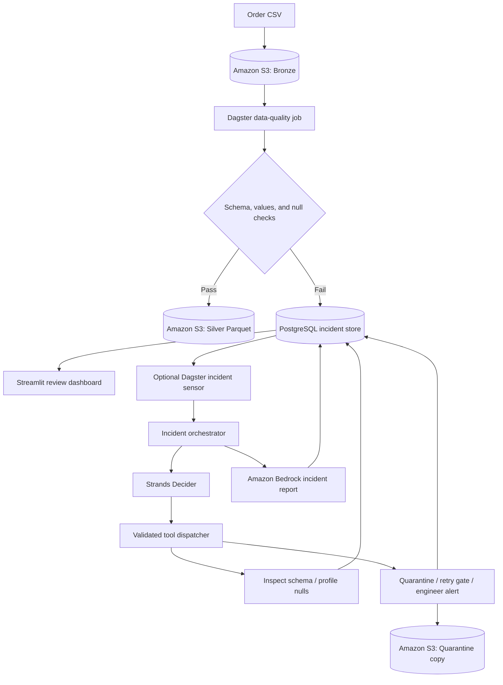

# Project Ullo

**Catch broken data before it reaches analytics. Investigate each failure with evidence.**


Ullo is an agentic DataOps prototype that validates order data in Amazon S3,
turns rejected batches into traceable incidents, and uses AI to select approved
investigation and remediation tools. Engineers can review the evidence,
decisions, and incident reports in a Streamlit dashboard.

**Good data becomes Parquet. Broken data becomes an actionable incident.**

[Quick start](#quick-start) · [Demo walkthrough](#demo-walkthrough) ·
[Architecture](#architecture) · [AI workflow](#ai-workflow) ·
[AWS deployment](docs/DEPLOYMENT.md) · [Current limits](#current-limits)

## The problem

A changed column, an invalid amount, or a spike in missing values can quietly
break downstream reporting. Detecting the bad file is only the first step:
someone still needs to identify the cause, preserve the evidence, and decide
what to do next.

Ullo brings those steps into one workflow. It is built for data engineers
operating batch pipelines and for teams that need a clear record of why a
dataset was accepted, rejected, quarantined, or escalated.

## What it does

| Capability | Implemented behavior |
| --- | --- |
| Validate incoming data | Check CSV readability, required columns, unexpected columns, compatible types, invalid values, and per-column null ratios. |
| Protect downstream datasets | Write accepted batches to the S3 Silver area as Parquet; reject an entire invalid batch. |
| Preserve the investigation | Store source URI, Dagster run ID, validation evidence, decisions, tool results, and reports in PostgreSQL. |
| Choose the next action | Use Strands Decider to select from a fixed set of investigation and remediation tools. |
| Explain an incident | Generate a report through Amazon Bedrock, with a deterministic fallback if the call fails. |
| Keep engineers involved | Review evidence and acknowledge, resolve, or escalate incidents from the dashboard. |

The data-quality checks are deterministic. AI enters the workflow after a
failure, where it helps choose tools and explain the incident. Model output is
validated before dispatch, and the application preserves the original Bronze file.

## Architecture



**Local mode:** Python applications + PostgreSQL + LocalStack S3.
**AWS hosting:** EC2 runs Dagster, Streamlit, and the Decider; S3 stores datasets;
RDS PostgreSQL stores incidents; Caddy provides HTTPS and a shared demo login.
Secrets Manager and an instance role supply cloud credentials at runtime.

## Quick start

Use **Python 3.12** for the recommended setup. The application targets Python
3.11+, and the regression suite has also been exercised on Python 3.13.
Git is required; Docker with Compose is needed for the full local demo.

### 1. Install

```bash
git clone https://github.com/ks-exe/project-ullo.git
cd project-ullo
python -m venv .venv
```

Activate the environment:

| Shell | Command |
| --- | --- |
| PowerShell | `.\.venv\Scripts\Activate.ps1` |
| macOS / Linux | `source .venv/bin/activate` |

On systems where Python is named `python3`, use that command to create the
environment. If PowerShell blocks activation, use
`.\.venv\Scripts\python.exe` in place of `python`.

```bash
python -m pip install --upgrade pip
python -m pip install torch==2.9.1 --index-url https://download.pytorch.org/whl/cpu
python -m pip install -r requirements.txt
```

The explicit PyTorch command selects CPU wheels. The Decider dependencies can
take time and disk space to install. Model weights download on first diagnosis;
ordinary validation jobs do not invoke the model.

### 2. Preview the validator without services

```bash
python scripts/mixed_data_demo.py
```

This checks the included synthetic fixtures without Docker, AWS credentials, a
database, or a model call. It prints each case's outcome and whether it matches
the expectation, then exits successfully when all match. Rejections are expected
for the broken fixtures.

### 3. Start the local data services

Copy the local example configuration once:

```powershell
# PowerShell
Copy-Item .env.example .env
```

```bash
# macOS / Linux
cp .env.example .env
```

```bash
docker compose up -d
docker compose ps
```

Wait for both services to become healthy. PostgreSQL initializes the incident
schema on a new volume. LocalStack creates a local S3 bucket and uploads the
clean, high-null, and schema-drift demo files. The credentials in `.env.example`
are dummy values for these local services.

### 4. Open the applications

Run each command in a separate terminal with the virtual environment active:

```bash
python scripts/run.py dagster --env-file .env
```

```bash
python scripts/run.py dashboard --env-file .env
```

| Application | Local address |
| --- | --- |
| Dagster jobs, runs, and assets | http://127.0.0.1:3000 |
| Incident review dashboard | http://127.0.0.1:8501 |

Keep `incident_remediation_sensor` stopped for this validation walkthrough.
LocalStack supplies S3 only; the local setup does not emulate Bedrock.

## Demo walkthrough

After setup, demonstrate the full data-quality path in three steps:

**1. Accept a clean batch.**

```bash
python scripts/run.py job --env-file .env
```

Open the Dagster run. Expect **SUCCESS** and a Silver Parquet object containing
the accepted rows.

**2. Reject a broken batch.**

```bash
python scripts/run.py job --env-file .env --config run_configs/schema_drift_demo.yml
```

This command intentionally exits with a failed run. The unexpected column should
produce a schema-drift incident, and that batch should have no Silver output.

**3. Show the evidence.**

Open the dashboard, click **Refresh**, and inspect the new incident. Match its
run ID to Dagster, review the source and schema evidence, and add an operator
note. Manual review actions update the incident record.

For the browser version of either run, open **Jobs → orders_data_quality_job →
Launchpad** and use:

```yaml
ops:
  bronze_orders:
    config:
      source_key: bronze/orders.csv
  silver_orders:
    config:
      source_key: bronze/orders.csv
```

Change **both** source keys to `bronze/unexpected_column.csv` for schema drift
or `bronze/high_nulls.csv` for a null-threshold failure.

## Data contract

The default schema is defined in
[`inspect_schema.py`](dataops_agent/tools/inspect_schema.py).

| Column | Expected value |
| --- | --- |
| `order_id` | Integer |
| `customer_id` | Integer |
| `order_date` | Date |
| `status` | String |
| `amount` | Float-compatible number |
| `currency` | String |

```csv
order_id,customer_id,order_date,status,amount,currency
1001,501,2026-10-01,paid,129.95,USD
1002,502,2026-10-01,paid,74.50,USD
```

The default null limit is **15% per column**: exactly 15% passes, more than 15%
fails. Column order may vary. Invalid batches are rejected as a whole; the
validator does not drop rows or fill missing values.

The [synthetic fixture set](sample_data/mixed_cases/README.md) includes boundary
null ratios, missing and extra columns, invalid values, empty/malformed CSVs, and
a bad amount in row 1,051. The latter exercises validation beyond the first
1,000 rows. These examples contain synthetic order data.

## AI workflow

The optional `incident_remediation_sensor` checks for pending incidents with a
minimum interval of 30 seconds and requests `incident_diagnosis_job` runs.
Workers claim incidents transactionally with `FOR UPDATE SKIP LOCKED`.

The orchestrator obtains an evidence decision, runs the selected tool, obtains
a remediation decision, executes that action, and saves a report.

| Approved tool | Responsibility |
| --- | --- |
| `inspect_schema` | Compare observed columns and types with the contract. |
| `profile_nulls` | Measure missing values and threshold breaches. |
| `quarantine_batch` | Copy the source object into quarantine while preserving Bronze. |
| `retry_pipeline` | Check retry limits and prepare rerun metadata. |
| `alert_engineer` | Record a manual-review result; optionally publish to a configured SNS topic. |

Malformed or unavailable Decider responses fall back to engineer review with
confidence zero. Bedrock failures produce a deterministic report. Decision
confidence, tool results, and the report remain available in the dashboard.

For AI diagnosis, configure a working CLI Decider or HTTP decision service.
Bedrock reports require AWS credentials and access to the configured model.
You can then run a single diagnosis:

```bash
python scripts/run.py job --env-file .env.aws.local --job incident_diagnosis_job
```

Alternatively, enable the incident sensor in Dagster's **Automation** view.
It can process all pending incidents in the configured database. Leave
`ALERT_SNS_TOPIC_ARN` empty to keep alerts inside the application.

## Configuration

Settings are validated in [`config/settings.py`](config/settings.py). Use
[`.env.example`](.env.example) for local services and
[`.env.aws.example`](.env.aws.example) for your own AWS resources. Real values
belong in ignored `.env` files.

| Variable | Purpose |
| --- | --- |
| `DATABASE_URL` | PostgreSQL connection URL; use the `postgresql+psycopg://` driver. |
| `AWS_REGION`, `AWS_PROFILE` | Region and optional local AWS profile. |
| `AWS_ENDPOINT_URL` | LocalStack URL in local mode; leave empty for AWS. |
| `S3_BUCKET_NAME` | Bucket containing the input and output prefixes. |
| `S3_BRONZE_PREFIX`, `S3_SILVER_PREFIX`, `S3_QUARANTINE_PREFIX` | Separate raw, accepted, and quarantined data. |
| `MAX_NULL_PERCENTAGE` | Per-column null limit, default `0.15`. |
| `DECIDER_MODE` | `cli` or `http`; examples use `cli`. |
| `STRANDS_DECIDER_MODEL_ID` | Model used by the CLI Decider. |
| `STRANDS_DECIDER_ENDPOINT`, `STRANDS_DECIDER_API_KEY` | Both required in HTTP mode. |
| `DECIDER_TIMEOUT_SECONDS` | Timeout for decision requests. |
| `BEDROCK_MODEL_ID` | Bedrock report model; examples use `amazon.nova-micro-v1:0`. |
| `ALERT_SNS_TOPIC_ARN` | Optional notification destination. |
| `MAX_RETRY_COUNT` | Limit used by the retry gate. |

For AWS, replace the example database and bucket placeholders, clear the
LocalStack endpoint and dummy keys, and use your own profile or instance role.
See [AWS deployment](docs/DEPLOYMENT.md) for prerequisites and commands.

## Tests

```bash
python -m pip install pytest
python -m pytest -q
python scripts/mixed_data_demo.py
```

The regression suite covers the synthetic validation cases, incident creation
for unreadable CSVs, environment selection, Dagster definitions, dashboard
startup, and exclusion of private files from deployment archives. These checks
use local fixtures and mocks; they require no live AWS services or database.

An optional integration run uploads fresh fixtures and runs against the
services in your chosen environment:

```bash
python scripts/mixed_data_demo.py --live --env-file .env.aws.local
```

Live runs create S3 objects and database incidents. Generated results are written
to ignored `reports/` and `.dagster_home/` directories.

## Repository map

```text
config/                 Validated settings and AWS client factories
dagster_project/        Data assets, jobs, and incident sensor
dataops_agent/          Decisions, orchestration, reports, and incident storage
  tools/               Five approved investigation/remediation tools
dashboard/             Streamlit incident review application
db/init/               PostgreSQL schema
localstack/init/       Local S3 initialization
sample_data/           Synthetic demo and regression fixtures
run_configs/           Ready-to-run schema-drift demo
scripts/               App launcher, demo runner, and AWS deployment helper
deploy/aws/            Hosting template, bootstrap, and service definitions
docs/DEPLOYMENT.md      AWS setup and maintenance guide
tests/                 Automated regression tests
```

## Current limits

- **Batch processing:** ingestion runs on a selected S3 object. Automatic
  ingestion for newly uploaded objects is not implemented.
- **Retry is a gate:** the retry tool records permission and rerun metadata;
  it does not launch a new Dagster run.
- **Human resolution updates status:** it does not repair source data.
- **In-memory processing:** CSV validation uses pandas and loads batches into
  memory; large datasets need a different execution strategy.
- **A focused contract:** uniqueness, positive amounts, and allowed
  currency/status values are not enforced.
- **Prototype operations:** shared demo authentication is not per-user access
  control. Stale investigation recovery and production hardening remain future
  work. Cloud resources and model use can incur charges.

## Troubleshooting

| Symptom | Check |
| --- | --- |
| Services are not healthy | Run `docker compose logs postgres localstack`; check ports 5432 and 4566. |
| Missing tables | A new local PostgreSQL volume runs `db/init/` automatically. For an existing database, apply the included SQL explicitly. |
| Missing S3 input | Check LocalStack initialization logs and the source key in both asset configs. |
| Dashboard cannot load incidents | Start it with the same environment file as the Dagster worker. |
| First diagnosis is slow | CLI mode may download weights and run inference on CPU. |
| Bedrock report falls back | Check the AWS profile, region, model access, and that the endpoint override is empty. |

Stop local services with `docker compose stop`. Persistent volumes retain local
data and history.
